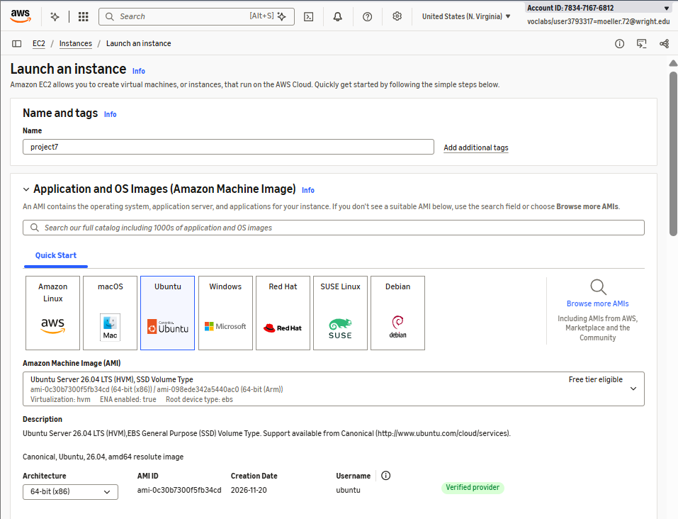
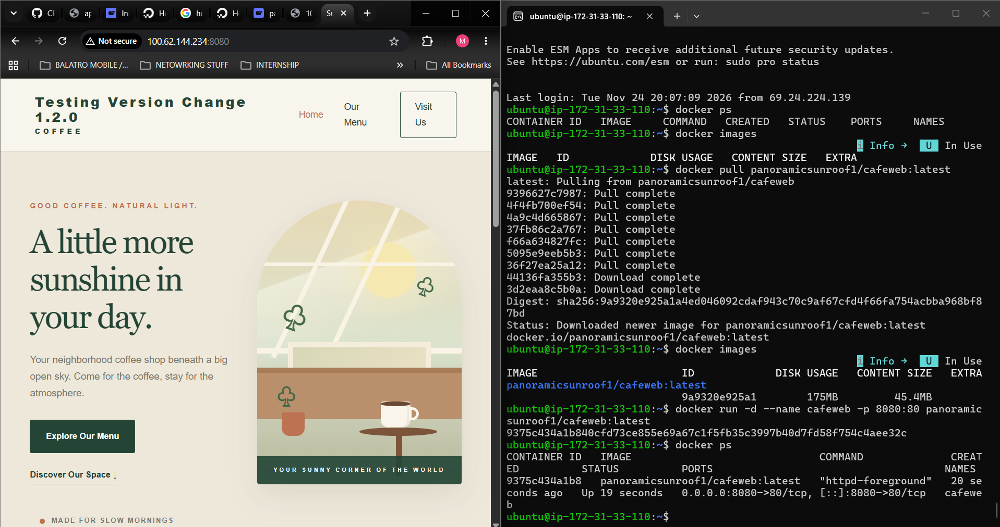
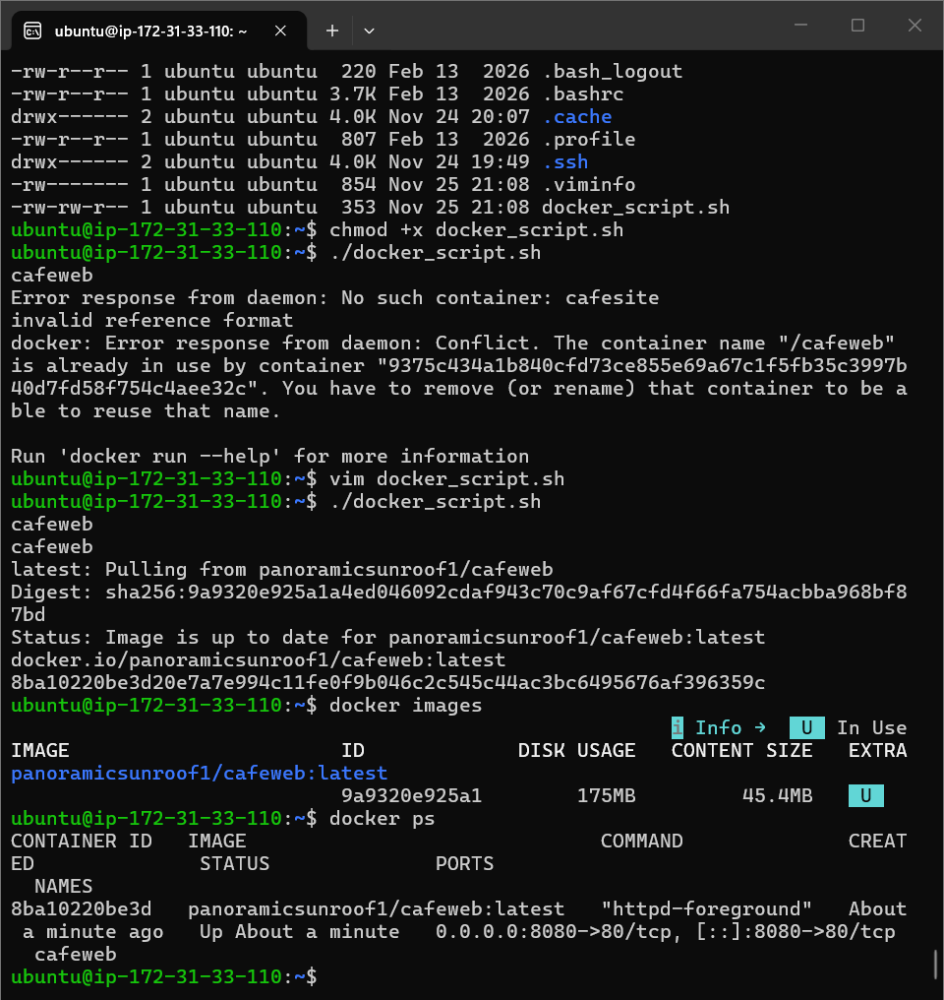

## Part 1

* Developing the EC2 instance.

* proof that ec2 has docker on it and that EC2 can run my website. 

* proof of script working in AWS

### Part 1 Sources

* [Digital Ocean Docker Install](https://www.digitalocean.com/community/tutorials/how-to-install-and-use-docker-on-ubuntu-22-04)