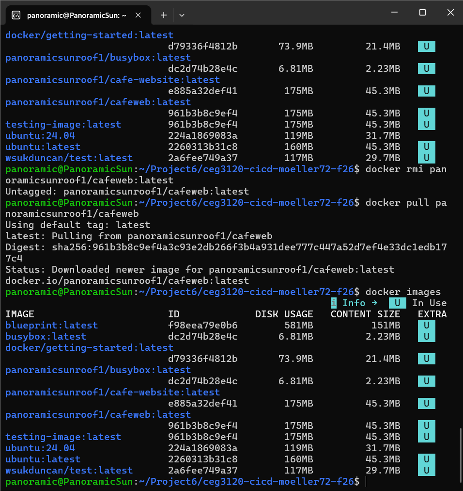
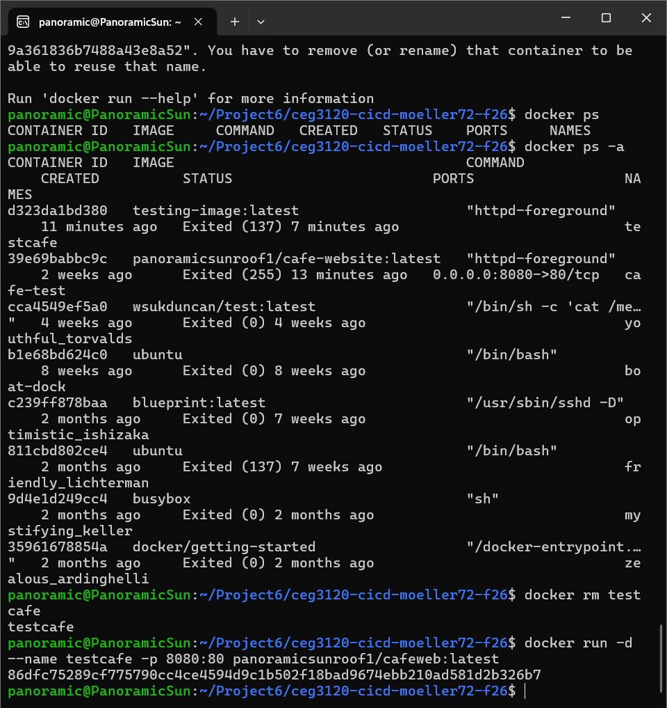
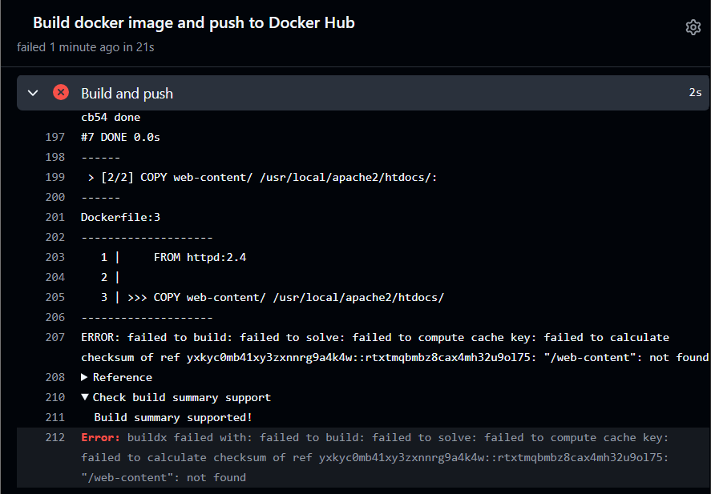
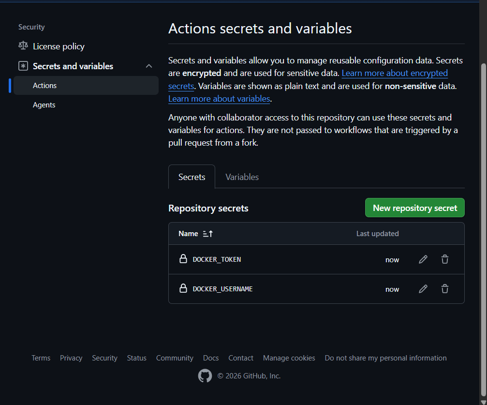
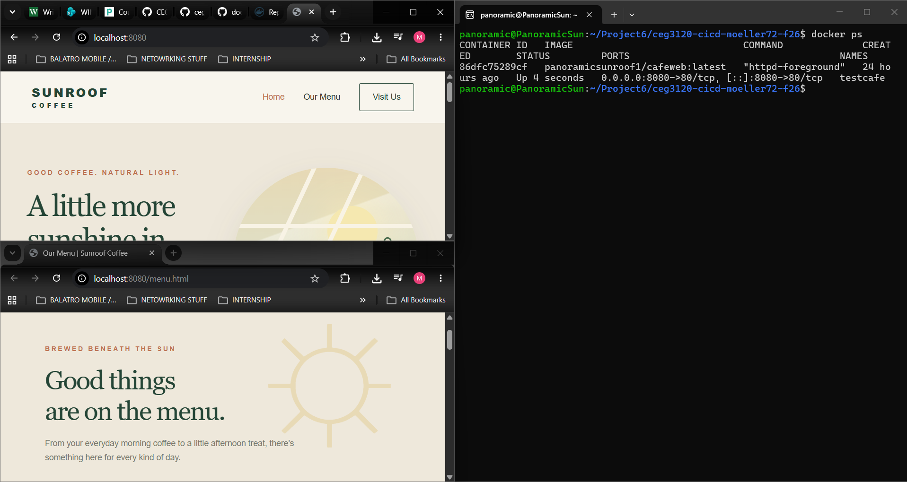
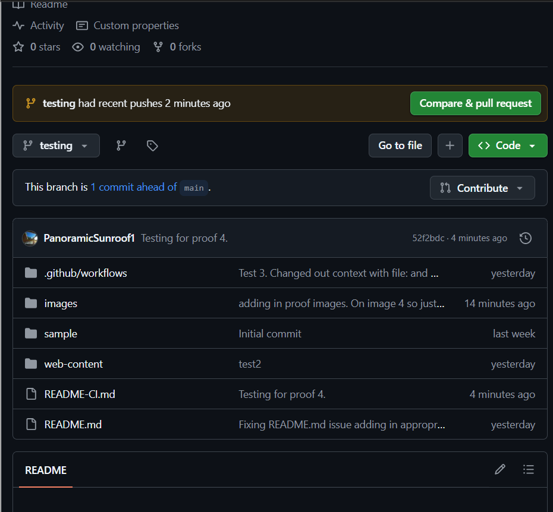
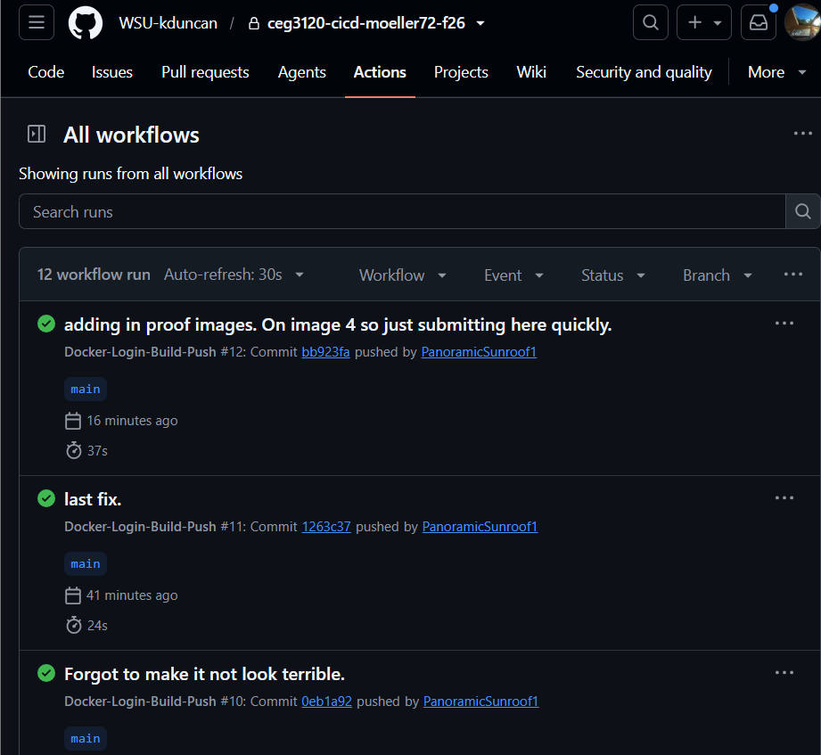
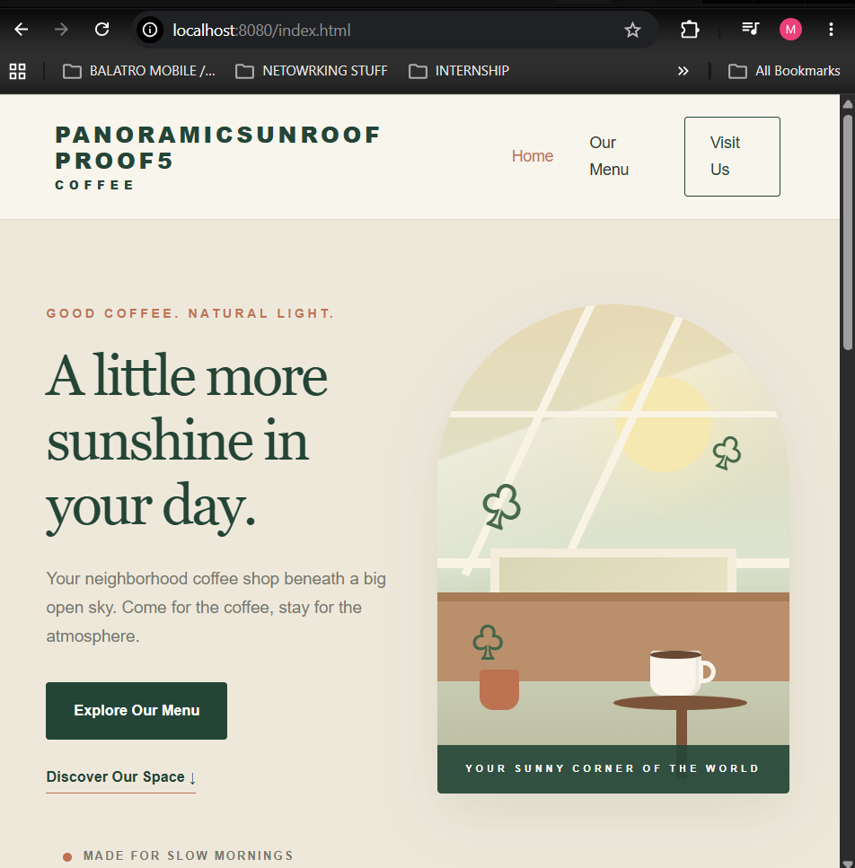
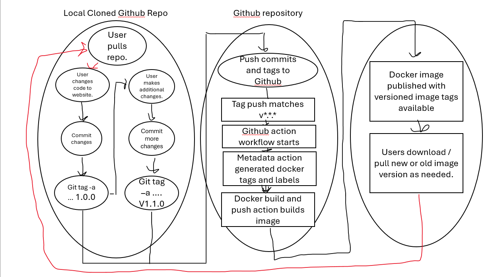

# CEG3120 - Course Work
Course work for CEG 3120 at Wright State University, Department of Computer Science and Engineering


## Building a web service Container

1. For this project I had Ai generate me a website with two pages and one CSS (Prompt can be found in the README.md inside of `web-content`) this site has a home page and menu page as it acts like a cafe website and then the css style sheet. (Home pages is on index.html menu being menu.html)

2. The Dockerfile is being used in this project to be a container with appache httpd2.4 with website files to be used on a server. [Dockerfile](web-content/Dockerfile) The commands inside this docker file are simply 
`FROM httpd:2.4`
`COPY web-content/ /usr/local/apache2/htdocs/`

3. The FROM uses Apache HTTP server image the 2.4 is the version of the image. The COPY command copys the content of folder (website files and all) into the `/usr/local/apache2/htdocs/` directory. Which is the default directory used by httpd.

4. (Much of this section I'll be putting in what i put at the bottom here) I built the docker container using the Dockerfile using `docker build -t test-image:latest -f web-content/Dockerfile .` This command builds the container with the tag of test-image:latest with `-f` meaning file / url i pointed it to `web-content/Dockerfile .` 

    * To run this I followed it up with `docker run -d --name test-image -p 8080:80 test-image:latest` which runs it detached with the name of test-image bound to hostport 8080 bound to port 80 `8080:80`.

    * I then logged into Docker hub on the command prompt using `docker login -u panoramicsunroof1` Then providing my newly made Personal Access Token it followed it up with Login Succeeded

    * I then pushed my containers image to a public DockerHub repo on my account. To ensure it was tagged correctly with my account username.

    * I ran `docker tag test-image:latest panoramicsunroof1/cafe-website:latest` which created a new tagged copy of the original `test-images:latest` to `panoramicsunroof1/cafe-website:latest` 

    * I then pushed it to my DockerHub account with ` docker push panoramicsunroof1/cafe-website:latest` which pushed that local image to my DockerHub public repo. 

    * To create the PAT I personally went onto Dockerhub went into Account settings then PAT, i created a PAT saved it somewhere secure and used that. I personally made it allowing read and write access so it can be pulled from Dockerhub. 

    * [Link to my Dockerhub](https://hub.docker.com/repository/docker/panoramicsunroof1/cafe-website/general)







## Part 2 Github Actions and DockerHub

1. For this project making the PAT is just the same as it was for project 5. I went onto Dockerhub and in Account settings I created a PAT with read and write privileges (which allows the ability to push and pull that repo). I then saved that to a secure place.

    * In the github repo Secrets tab in settings I created DOCKER_USERNAME with my docker username as the variable and DOCKER_TOKEN with the PAT that I just created. 

2. For this work flow the name was `Docker-Login-Build-Push` With the event / action triggers being. `On push to the main branch`

<br>


<br>

* This shows that the trigger is when its pushed to the main branch. This is the area you would edit the file to change the trigger.


* This section is the steps that occur in order starting from Checkout repo with `checkout@v7`. From my research on the topic this was the latest version I could find.

    * The next step is for docker buildx with `setup-buildx-action@v4` From what I could find v4 was the most recent version.

    * The next step is to login to docker hub using `login-action@v4` Version 4 was the most recent version I could personally find. this has a `with` tag with the username and password having `secrets.DOCKER_USERNAME` and the password. This makes it when pushed to main it will login in and with the secrets it will look at the secrets tab looking for the names `DOCKER_USERNAME` and `DOCKER_TOKEN` which have been saved to secrets. 
    
    * (update: 11/10/2026. While looking over everything i se the note for v2 allowing the use of `buildx`. The link for me Doesn't seem to work so I'm not sure if that's required so Ill continue and look back at it once part 2 is complete and if its needed for part 3)

    * Lastly the laststep is build and push this uses `build-push-action@v7` which is the most recent version I could personally fine. It got accidentially cropped out of the image but in the `with` tab it has: 
```
    file: ./web-content/Dockerfile
          push: true
          tags: ${{ secrets.DOCKER_USERNAME }}/${{ env.DOCKER_HUB_REPO }}:latest
```
* This shows that its pointed at my Dockerfile in the folder `web-content/Dockerfile` with `push` being `true` so it will `push` on commit to main. With tags of `secrets` using my docker username and token with the environment being the repo `cafeweb` using the latest version. (I noticed the image also cropped out `DOCKER_HUB_REPO` but I had to change that repo name to `cafeweb` above to point at it correctly.)


* [Part2 Permalink](https://github.com/WSU-kduncan/ceg3120-cicd-moeller72-f26/blob/0eb1a92563f3358048dbe324ad2bfc0bd317b270/.github/workflows/docker-workflow.yml)


* [Link to my Dockerhub](https://hub.docker.com/repository/docker/panoramicsunroof1/cafe-website/general)


* This is after the fails. I just ran the third test after pointing the file toward my `Dockerfile` inside `web-content` it ran and claims it was successful. I Also checked Docker hub and it did confirm that it pushed to my docker hub (images below).
<br>


<br>


<br>


* Documenting Fails along the way. This was after my first test after adding in `.github/workflows/docker-workflow.yml` Judging by what im reading I need to add a way to point the script towards the folder `/web-content`.

* Test 2 failed for the same reason just different execution. I pointed the context to the folder `/web-content` from what I read that simply treats that as the Root Directory So it wasn't exactly need. Instead I will replace context with a `file` tag as well and point at the dockerfile with `./web-content/Dockerfile`


<br>


<br>




## Part 2 Proof

1. 

<br>

* This proves that the after running my `dockerfile` to my docker hub, pulling it and running it the local host does show my webpages using its CSS.

2. 

<br>

* This Proves that i have added secrets in the github actions which will be used by the workflow.

3. 

<br>

* This proves that after I commit to `main` it shows a successful workflow and its sha value.

4. 


<br>

* This proves that after i created a branch (Test) and pushed it to github it did not run the workflow

5. 

<br>

* This proves that after i edited my `index.html` file that after being pushed to main and the workflow ran it successfully pushed to my `dockerhub` which i pulled and ran for this image.

## Part 3

1. Generating `tag`s

* to see tage in a github repo you want to run either `git tag` or `git tag -l` 

* To generate a tag you want to run `git tag -a v#.#.# -m "commit message here"`
    * With `git tag -a` the `-a` means annotate (to note it is not required to use `-a` from this link [Gittag](https://git-scm.com/book/en/v2/Git-Basics-Tagging) I used to help me understand tagging more other options are available but `-a` is noted as one of the simplest ways.) Followed by `v#.#.#` which is the version number you want then `-m ""` which is the tag commit message.

* From the same source referenced above the way you push a tag (I messed this up) Is `git push origin v#.#.#` not just git push (which is what I tried.)

2. Versioning explanation.

* The new trigger is now 
```
on:
  # triggers on push to main branch
  push:
    tags:
      - 'v*.*.*'
```
* This is essentially on a push, trigger when a tag following `v*.*.*` for my test it was `v1.0.0` and `v1.1.0`

* The major changes on the workflow steps are.

```
       name: Build and push

        id: docker_build 
        uses: docker/build-push-action@v7
        with:
          file: ./web-content/Dockerfile
          push: true
          tags: ${{ steps.meta.outputs.tags }}
          labels: ${{ steps.meta.outputs.labels }}
          # Example getting fancy with tags: 
          #   https://github.com/docker/build-push-action/blob/master/docs/advanced/tags-labels.md
```

And

```
name: Docker meta
        id: meta
        uses: docker/metadata-action@v6
        with:
          images: ${{ secrets.DOCKER_USERNAME }}/${{ env.DOCKER_HUB_REPO }}
          tags: |
            type=semver,pattern={{major}}
            type=semver,pattern={{major}}.{{minor}}
```

* From build and push the tags were added being `tags: ${{ steps.meta.outputs.tags }}` and `labels: ${{ steps.meta.outputs.labels }}`
    * The new `tags` line will retrieve the generated docker image tag and passes them into the build and push step. This is used to version the image publish on dockerhub (`1.0.0 1.1.0 1.2.0` etc.).

    * labels Retrieves the docker image `lables` and passes them into the push step and applies the `metadata` to it. Which provides additional information about said image.

    * For the Dockerhub repo, when i added in the new major tag v1.0.0 docker now has that as the main version and I confirmed after also submitting v1.1.0 that v1.0.0 was not touched so it can be looked back at.

3. 

* I tested to ensure my workflow did its tasking by changing my index file in all my renditions a little bit. in `1.0.0` i kept it the same as when I changed it for Part 2. for 1.1.0 I changed the header and I did it one more time for 1.2.0 to confirm that the versions do change and also hold on to the previous version.

* I verified the image by pulling the new dockerhub version onto my local pc, running it and looking at my index page to see if the change applied.

[Dockerhub Repo](https://hub.docker.com/repository/docker/panoramicsunroof1/cafeweb/general)

* This link will take you to my panoramicsunroof1/cafeweb repo and in the tags section you can see my versions `1, 1.0, 1.1, and 1.2` (I used 1.0.0 so i imagine it wont show the final .0 until I add in a patch version which was not required.)

## Part 3 Proof images

6. 
<br>


<br>

7. 
<br>

<br>

8. 
<br>

<br>

9. 
<br>

<br>

10. 
<br>

<br>

## Part 4 Diagram

* 

* This diagram shows a flow and loop of how this github action workflow would run. It starts with the user making changes, commiting them and then adding a tag and commiting the tag as well. In the github repo if your tag follows the versioning.
```
on:
  # triggers on push to main branch
  push:
    tags:
      - 'v*.*.*'
```
* it will begin the workflow, moving to the `metadata` to get the tags and labels as nessesary and then build and push will tag as needed and push it to docker hub

* In docker hub the image becomes published with a tag of the version which allows users to pull the specific version they would like. This can loop back around to a user / developer pulling that new image and adding more and so on. (pulling obviously isn't required for the developer in this project, but lets say this was an open project to multiple people to edit as they see fit, that would be a step.)


    * [Path to workflow](.github/workflows/docker-workflow.yml)

## Sources

[Help configuring GitHub actions](https://docs.docker.com/build/ci/github-actions/configure-builder/#version-pinning)

[More help with Configuring Github actions](https://github.com/docker/login-action)

[Additional Help with actions](https://github.com/marketplace/actions/build-and-push-docker-images)

[Inputs and tags for build-push actions.](https://github.com/docker/build-push-action#inputs)

[Help with understanding how to use git tag.](https://git-scm.com/book/en/v2/Git-Basics-Tagging)