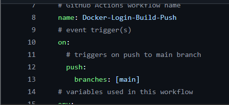
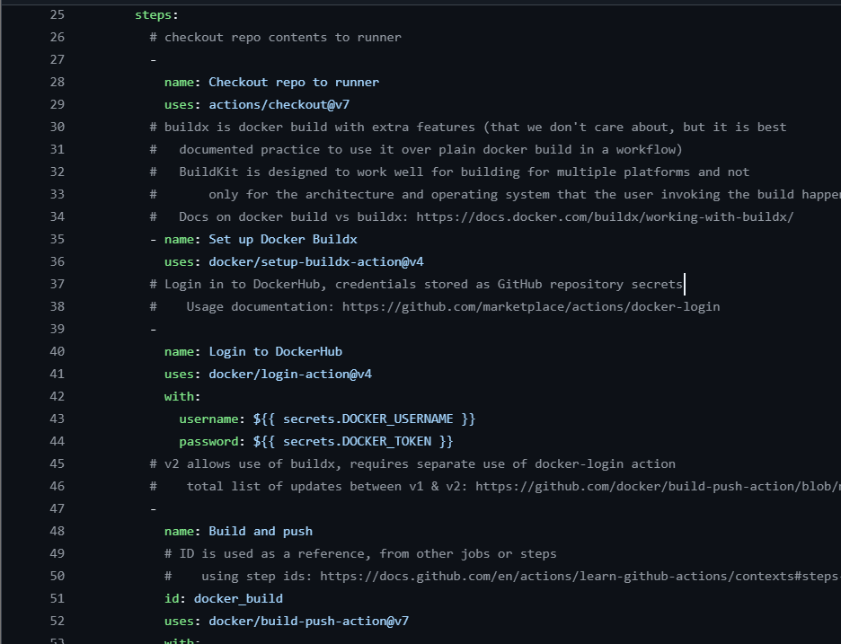
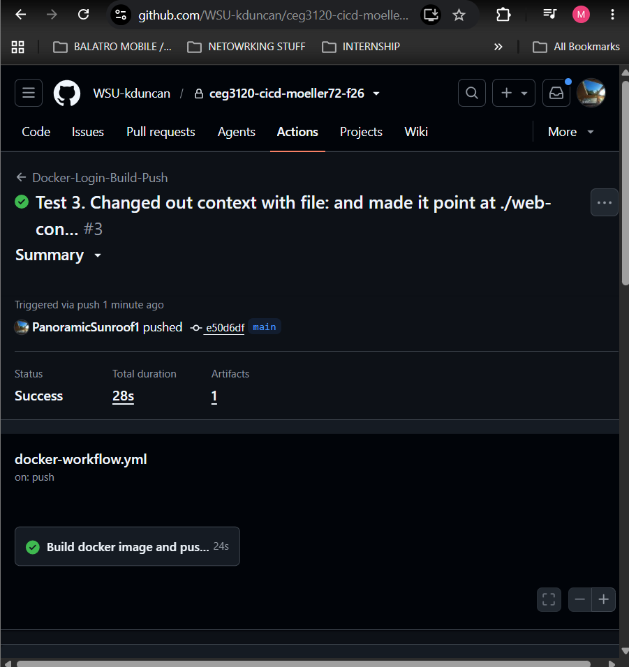
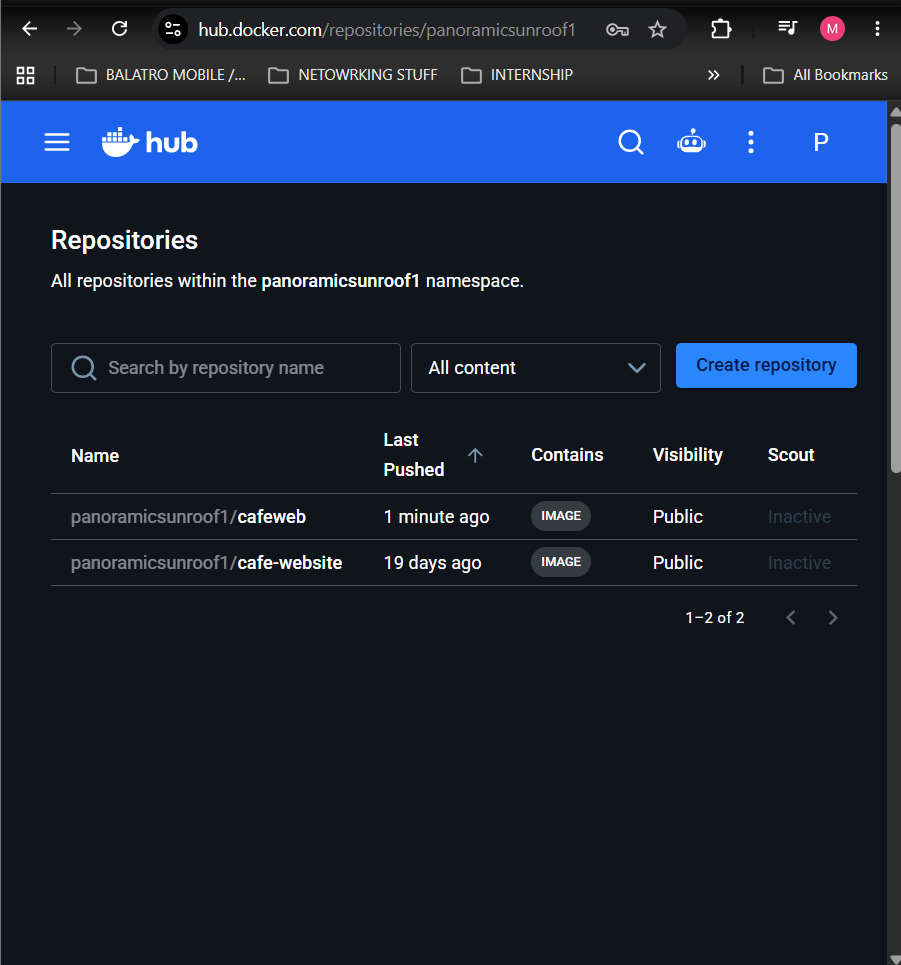
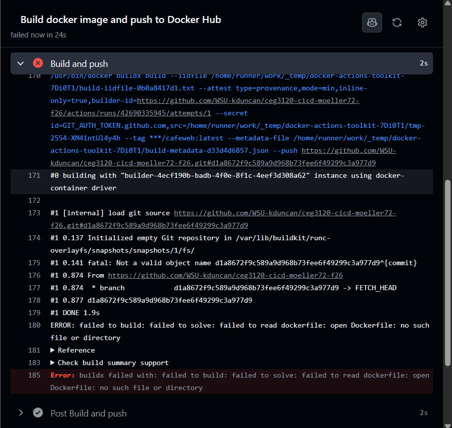

# CEG3120 - Course Work
Course work for CEG 3120 at Wright State University, Department of Computer Science and Engineering

## Building a web service Container

1. For this project I had Ai generate me a website with two pages and one CSS (Prompt can be found in the README.md inside of `web-content`) this site has a home page and menu page as it acts like a cafe website and then the css style sheet. (Home pages is on index.html menu being menu.html)

2. The Dockerfile is being used in this project to be a container with appache httpd2.4 with website files to be used on a server. [Dockerfile](web-content/Dockerfile) The commands inside this docker file are simply 
`FROM httpd:2.4`
`COPY web-content/ /usr/local/apache2/htdocs/`

3. The FROM uses Apache HTTP server image the 2.4 is the version of the image. The COPY command copys the content of folder (website files and all) into the `/usr/local/apache2/htdocs/` directory. Which is the default directory used by httpd.

4. (Much of this section I'll be putting in what i put at the bottom here) I built the docker container using the Dockerfile using `docker build -t test-image:latest -f web-content/Dockerfile .` This command builds the container with the tag of test-image:latest with `-f` meaning file / url i pointed it to `web-content/Dockerfile .` 

    * To run this I followed it up with `docker run -d --name test-image -p 8080:80 test-image:latest` which runs it detached with the name of test-image bound to hostport 8080 bound to port 80 `8080:80`.

    * I then logged into Docker hub on the command prompt using `docker login -u panoramicsunroof1` Then providing my newly made Personal Access Token it followed it up with Login Succeeded

    * I then pushed my containers image to a public DockerHub repo on my account. To ensure it was tagged correctly with my account username.

    * I ran `docker tag test-image:latest panoramicsunroof1/cafe-website:latest` which created a new tagged copy of the original `test-images:latest` to `panoramicsunroof1/cafe-website:latest` 

    * I then pushed it to my DockerHub account with ` docker push panoramicsunroof1/cafe-website:latest` which pushed that local image to my DockerHub public repo. 

    * To create the PAT I personally went onto Dockerhub went into Account settings then PAT, i created a PAT saved it somewhere secure and used that. I personally made it allowing read and write access so it can be pulled from Dockerhub. 

    * [Link to my Dockerhub](https://hub.docker.com/repository/docker/panoramicsunroof1/cafe-website/general)

## Part 2 Github Actions and DockerHub

1. For this project making the PAT is just the same as it was for project 5. I went onto Dockerhub and in Account settings I created a PAT with read and write privileges (which allows the ability to push and pull that repo). I then saved that to a secure place.

    * In the github repo Secrets tab in settings I created DOCKER_USERNAME with my docker username as the variable and DOCKER_TOKEN with the PAT that I just created. 

2. For this work flow the name was `Docker-Login-Build-Push` With the event / action triggers being. `On push to the main branch`

 

 

    *  

* This is after the fails. I just ran the third test after pointing the file toward my `Dockerfile` inside `web-content` it ran and claims it was successful. I Also checked Docker hub and it did confirm that it pushed to my docker hub (images below).
 

 

 

* Documenting Fails along the way. This was after my first test after adding in `.github/workflows/docker-workflow.yml` Judging by what im reading I need to add a way to point the script towards the folder `/web-content`.

* Test 2 failed for the same reason just different execution. I pointed the context to the folder `/web-content` from what I read that simply treats that as the Root Directory So it wasn't exactly need. Instead I will replace context with a `file` tag as well and point at the dockerfile with `./web-content/Dockerfile`

 

 

## Sources

[Help configuring GitHub actions](https://docs.docker.com/build/ci/github-actions/configure-builder/#version-pinning)

[More help with Configuring Github actions](https://github.com/docker/login-action)

[Additional Help with actions](https://github.com/marketplace/actions/build-and-push-docker-images)

[Inputs and tags for build-push actions.](https://github.com/docker/build-push-action#inputs)

